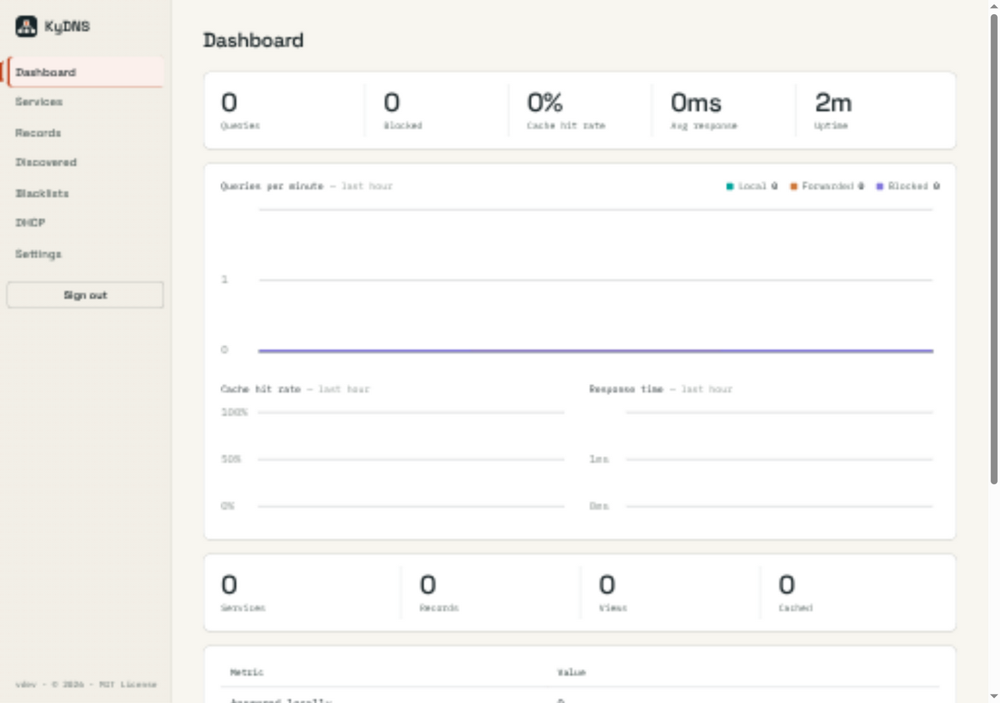
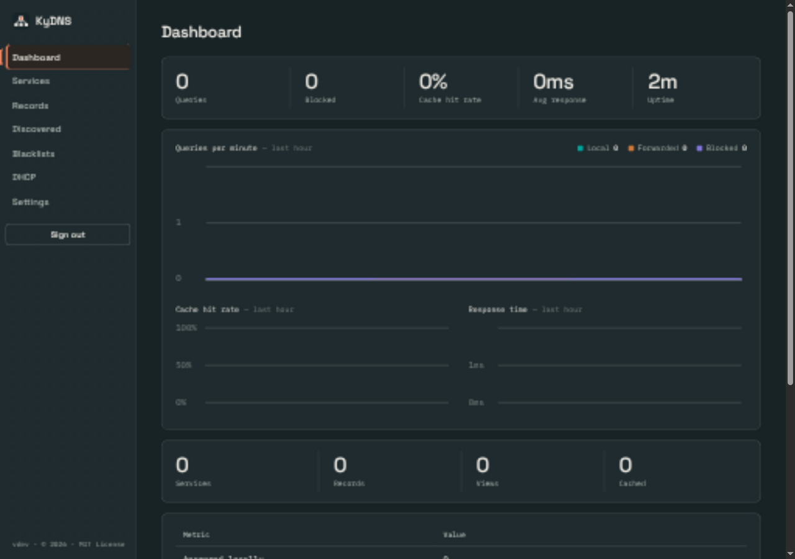
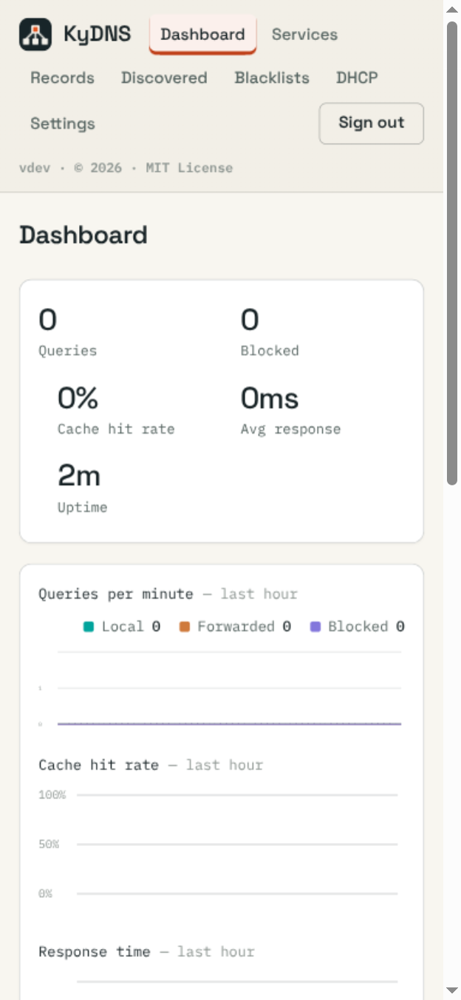
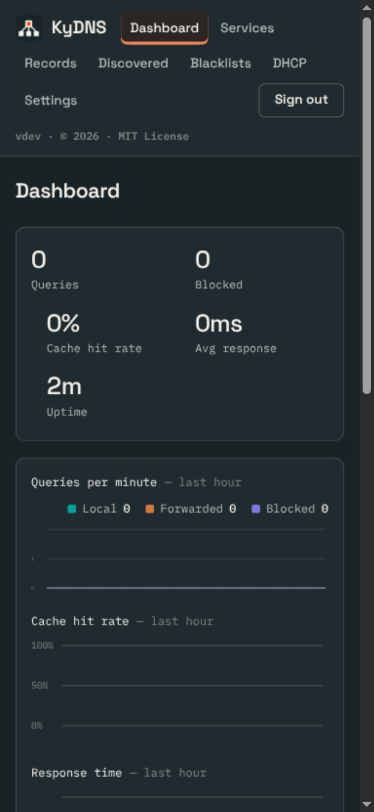

# Shared UI verification

> Evidence scope: this document records the revision, environment and capture conditions below. Screenshots and generated fixtures demonstrate appearance; they do not qualify live email delivery, push delivery, recovery custody or every product feature. Test counts describe that recorded run, not the current suite.

## Change

Generate Busnes palette previews from shared tokens and verify vendored assets in CI. Shared assets are pinned to ky-ui 0.2.0 with content hashes. Product layouts, saved theme keys and named presets remain local.

## Capture conditions

Captured 2026-09-25 from this branch, using the application UI (not a design mockup). Dashboard in a real scratch server, with no configured DNS records or query traffic.

OS-following Busnes Light and Dark were captured at 1280×900 and 390×844 CSS pixels. Browser device scaling may make PNG dimensions larger. Document width stayed within the viewport in these captured states; local navigation/table scrolling is intentional. Screenshots show the selected-page accent, not a complete accessibility audit.

No complete end-to-end product workflow or exhaustive named-theme audit is claimed.

## Checks

go test ./internal/web passed; vendor integrity check passed. Central ky-ui sync --check verified all ten consumers. Screenshot coverage is Busnes Light/Dark; existing named choices are retained, but not every named palette/page combination was visually exercised.

## Screenshots

| Light | Dark |
| --- | --- |
|  |  |
|  |  |

## Reproduce

Run the Go server with isolated preview data following its README; run the checks above from the repository root. Use System theme, emulate OS light/dark, and inspect both viewport sizes. Do not point preview instances at production data. For KyVault, use a configured development KyIdentity or explicitly labeled read-only browser fixtures; never bypass backend authentication.

## Services health UI removal — 2026-10-26

Verified the actual Services page on a scratch server with three services, one
proxy route and one alias, in Busnes Dark at 1280×800 and 390×844 CSS pixels.
The health column, check URL, self-signed certificate control and health polling
are absent. Document width matched both viewports; the service table retains
its existing local horizontal scrolling on mobile. Screenshots were captured
with the T3 collaborative browser as session artifacts, not committed fixtures.
Other themes and production deployment were not exercised for this change.

`make test`, `make build`, `go vet ./...`, vendor integrity, JavaScript syntax,
and the AGENTS.md installer-boundary race checks passed. The targeted Services
template detector reported no findings. A regression test verifies that the
Services page neither renders health controls nor reads the health provider;
existing session/API monitoring endpoints remain available.

## 2026-10-26 fleet Appearance

ky-ui 0.4.0 (shared source `4f83f34`): the Appearance theme-card picker over the shared catalog, plus shell geometry from shared tokens. Before/after screenshots, capture conditions, hashes, real-browser behaviour checks and the results spreadsheet are in [docs/ui-fleet-2026-10-26](docs/ui-fleet-2026-10-26/README.md). Ratings are set by the independent council, not this record.

## Fleet visual refinement (2026-10-26)

Phone dashboard: brand and Sign out on one row with a single sideways-scrolling navigation row that keeps the current page in view (203px → 113px); the licence button moves below the page on phones; charts draw in CSS pixels, so axis labels are 12px at every width; phone stats use two shared column edges. Stage 01 shows a class collision with the marketing `.nav-links`, fixed in stage 02. Before/after captures (light/dark × 1280×900/390×844, synthetic fixture, clean commits), manifests with hashes, behaviour checks and CSVs are in [docs/ui-visual-refinement-2026-10-26](docs/ui-visual-refinement-2026-10-26/README.md). No score is self-assigned.
